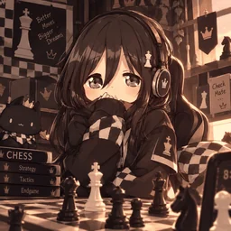
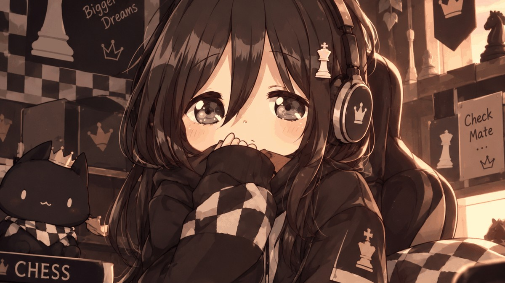
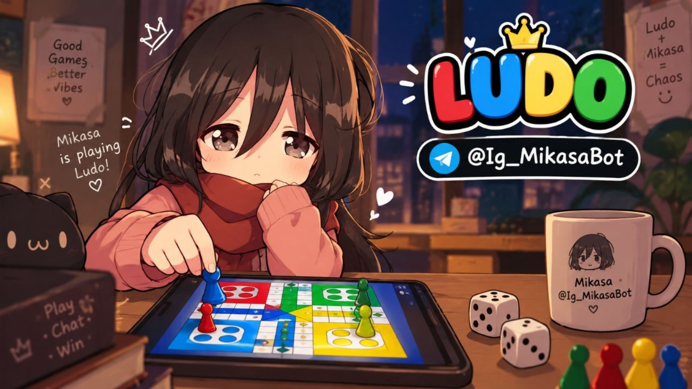
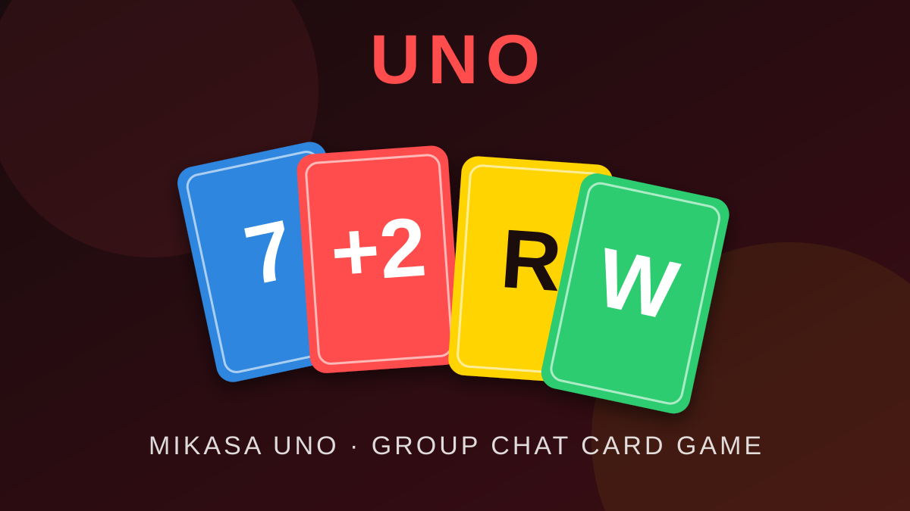

<div align="center">




#### 𝓜𝓲𝓴𝓪𝓼𝓪 𝓗𝓾𝓫 · three games, one bot family


<p>
  <a href="https://t.me/Ig_MikasaBot"></a>
  <a href="https://t.me/Ig_MikasaBot/Chess"></a>
  <a href="https://t.me/Ig_MikasaBot/ludo"></a>
  <a href="https://t.me/Ig_MikasaBot?startgroup=true"></a>
</p>


</div>

---

## 🎮 The games

<table align="center">
  <tr>
    <td align="center" width="33%">
      <a href="apps/chess"></a>
      <h3>♞ Chess</h3>
      Real-time multiplayer chess<br/>with lobbies, spectators and chat.<br/><br/>
      <a href="https://t.me/Ig_MikasaBot/Chess"></a>
    </td>
    <td align="center" width="33%">
      <a href="apps/ludo"></a>
      <h3>🎲 Ludo</h3>
      Live Ludo rooms with fair<br/>server-side dice and victory images.<br/><br/>
      <a href="https://t.me/Ig_MikasaBot/ludo"></a>
    </td>
    <td align="center" width="33%">
      <a href="apps/uno"></a>
      <h3>🃏 UNO</h3>
      Play UNO in any group chat<br/>with classic, fast and wild modes.<br/><br/>
      <a href="https://t.me/Ig_MikasaBot?startgroup=true"></a>
    </td>
  </tr>
</table>

---

## 🧩 Projects

| | App | What it is | Stack | Path |
|:-:|---|---|---|---|
| ♞ | **[Chess](apps/chess)** | Multiplayer Mini App with lobbies, spectators, draw offers and a built-in bot | React · Socket.IO · Express | `/chess/` |
| 🎲 | **[Ludo](apps/ludo)** | Multiplayer Mini App with fair dice, turn timer, chat and match history | React · WebSocket · Express | `/ludo/` |
| 🃏 | **[UNO](apps/uno)** | Group-chat card game played through inline mode | Python 3.14 · python-telegram-bot 22 | `/uno/` |

A small **gateway** (`gateway/gateway.mjs`) runs all three on one Render port. It strips the path prefix, forwards HTTP and WebSocket traffic, and restarts any app that crashes. **A crashed bot never takes the others down.**

---

## 🚀 Deploy

<details>
<summary><b>Step-by-step deploy on Render (click to expand)</b></summary>

<br/>

1. **Create three bots** with [@BotFather](https://t.me/BotFather), one per app. Each needs its own token.
2. **Set the Mini App URLs** in BotFather:
   - Chess bot: `https://<your-service>.onrender.com/chess`
   - Ludo bot: `https://<your-service>.onrender.com/ludo`
3. **Create the service:** Render → **New → Blueprint** → pick this repo.
4. **Fill in the variables:**

| Variable | Value |
|---|---|
| `CHESS_BOT_TOKEN` | Chess bot token |
| `CHESS_BOT_USERNAME` | Chess bot handle, without `@` |
| `LUDO_BOT_TOKEN` | Ludo bot token |
| `LUDO_BOT_USERNAME` | Ludo bot handle, without `@` |
| `UNO_BOT_TOKEN` | UNO bot token |
| `MAIN_BOT_USERNAME` | Handle the "Main Bot" button opens (default `Ig_MikasaBot`) |
| `DATABASE_URL` | Neon Postgres connection string (`?sslmode=require`) |
| `CHESS_MINIAPP_SHORT_NAME` | Optional, default `Chess` |
| `LUDO_MINIAPP_SHORT_NAME` | Optional, default `ludo` |
| `IDENTITY_SECRET` | Optional. Signs player identity tokens for Chess and Ludo. Defaults to each app's bot token. Set it to rotate every player token at once. |

5. **Deploy** with **Manual Deploy → Clear build cache & deploy**. Clear the cache on the first deploy and after any dependency change.

If a token is missing, only that bot is disabled. The others keep running.

</details>

<details>
<summary><b>Database, endpoints and stability rules</b></summary>

<br/>

**Database (Neon Postgres).** Ludo stores profiles, match history and chat in `app_state`. UNO stores stats and settings in tables that Pony ORM creates on first start. Chess keeps its match history in the `chess_match_records` table, written by the server when a game ends, so players cannot edit their own results. Live Chess rooms stay in memory. If `DATABASE_URL` is empty or unreachable at start-up, Ludo and UNO fall back to local files and log a warning, and Chess history is kept in memory only. Those files and that memory are lost on redeploy, so check the logs after each deploy.

**Memory limits.** The free instance has 512 MB for all four processes, so each game server cleans up after itself. Chess and Ludo remove finished games after 2 hours, games with nobody connected after 1 hour, and any game after 12 to 24 hours. Each server holds at most 1000 games at once and refuses new ones beyond that with a "server is full" message. Names, chat text, avatars and game settings from players are length-checked before they are stored, WebSocket messages over 1 MB are rejected, and a malformed message is logged and ignored instead of crashing the server. Saved match history in Postgres is not affected by any of this. Errors are logged with bot tokens and secrets removed.

**Endpoints.**

| Route | Returns |
|---|---|
| `GET /` | Status page |
| `GET /health` | JSON with each app's state and restart count (Render health check) |
| `/chess/*`, `/ludo/*`, `/uno/health` | The apps |

**Rules that keep it stable.**
- Each bot needs its own token. Two services polling one token cause Telegram error **409**.
- Keep the free tier awake with an UptimeRobot monitor on `/health`.
- Python 3.14 is the tested version (the Dockerfile's `PYTHON_VERSION` build argument). UNO supports 3.10 to 3.14, so a change of version is a build argument, not a code change.

</details>

<details>
<summary><b>Local run</b></summary>

<br/>

```bash
cd apps/chess && npm ci && APP_BASE=/chess npm run build && cd ../..
cd apps/ludo  && npm ci && APP_BASE=/ludo  npm run build && cd ../..
uv venv --python 3.14 /opt/venv && uv pip install --python /opt/venv/bin/python -r apps/uno/requirements.txt

PYTHON=/opt/venv/bin/python PORT=10000 \
  CHESS_BOT_TOKEN=... LUDO_BOT_TOKEN=... UNO_BOT_TOKEN=... \
  node gateway/gateway.mjs
```

</details>

---

## 💾 Persistence on the free plan

Render's free filesystem resets on every deploy and restart. Without a database, this affects Ludo profiles and match history, UNO stats, and live Chess rooms (held in memory). With `DATABASE_URL` set to Neon, Ludo, UNO and Chess match history survive redeploys. Live Chess rooms are always in memory.

---

## 🔧 Changes made to the original apps

- **Client (Chess, Ludo):** every root-absolute URL goes through `appPath()` in `src/utils/basePath.ts`, and Vite `base` is set from `APP_BASE`.
- **Server (Chess, Ludo):** server-generated paths carry `APP_BASE`.
- **UNO:** `/help` is an ephemeral command in groups (Bot API 10.3: only the sender and the bot see the guide), the guide image is removed, and `/start help` deep links work.
- **Ludo:** new Telegram bot (`server/telegramBot.ts`) and the `telegraf` dependency.
- **Housekeeping:** removed stale per-app deploy guides, an unused AI Studio manifest and committed runtime data. Added a root `.gitignore`.

---

## 📁 Repository layout

```text
MikasaHub/
├── gateway/gateway.mjs      # one port, three apps, auto-restart
├── apps/
│   ├── chess/               # React + Socket.IO Mini App and bot
│   ├── ludo/                # React + WebSocket Mini App and bot
│   └── uno/                 # Python group-chat bot
├── assets/readme/           # images used by this README
├── Dockerfile · render.yaml # one-click Render Blueprint
└── README.md
```

---

<div align="center">

**Good moves · Fair dice · Dealt with care**


*Made with 🖤 for Mikasa's friends*

</div>
